<picture>
  <source media="(prefers-color-scheme: dark)" srcset="assets/header-dark.svg">
  <source media="(prefers-color-scheme: light)" srcset="assets/header-light.svg">
  
</picture>

 

Backend engineer working with Python and Django. Currently building AsanOption and UKJobHunters.

## Selected work

### AsanOption

<picture>
  <source media="(prefers-color-scheme: dark)" srcset="assets/asanoption-dark.svg">
  <source media="(prefers-color-scheme: light)" srcset="assets/asanoption-light.svg">
  
</picture>

A web platform that makes options simple and understandable for crypto and Iranian-market traders, with analytics, risk tools and built-in AI. Source is private.

Design principle: silence is better than a wrong number. When data is stale or thin, the product shows no figure.

[Visit asanoption.com](https://www.asanoption.com) (Persian)

### UK Job Hunters

A web platform that helps international professionals find UK jobs with employers that may sponsor a Skilled Worker visa. It combines a searchable database of licensed sponsors, an eligibility assessment and a job search assistance service run by human case workers. Source is private.

[Visit ukjobhunters.com](https://www.ukjobhunters.com)

### mini-rag-service

<picture>
  <source media="(prefers-color-scheme: dark)" srcset="assets/flow-dark.svg">
  <source media="(prefers-color-scheme: light)" srcset="assets/flow-light.svg">
  
</picture>

A hybrid retrieval API. BM25 and vector search are fused with Reciprocal Rank Fusion, then re-ranked with MMR to keep the returned context diverse. Built with Django REST framework, with Persian-language support, and Claude-ready. MIT licensed.

[View on GitHub](https://github.com/Alirezarsld/mini-rag-service)

### Azad Internet TV

An internet TV and learning platform for Azad University: live and recorded video, a built-in messenger and faculty channels, on web and Android. Source is private.

## Stack

`Python` `Django` `DRF` `Celery` `Redis` `PostgreSQL`
